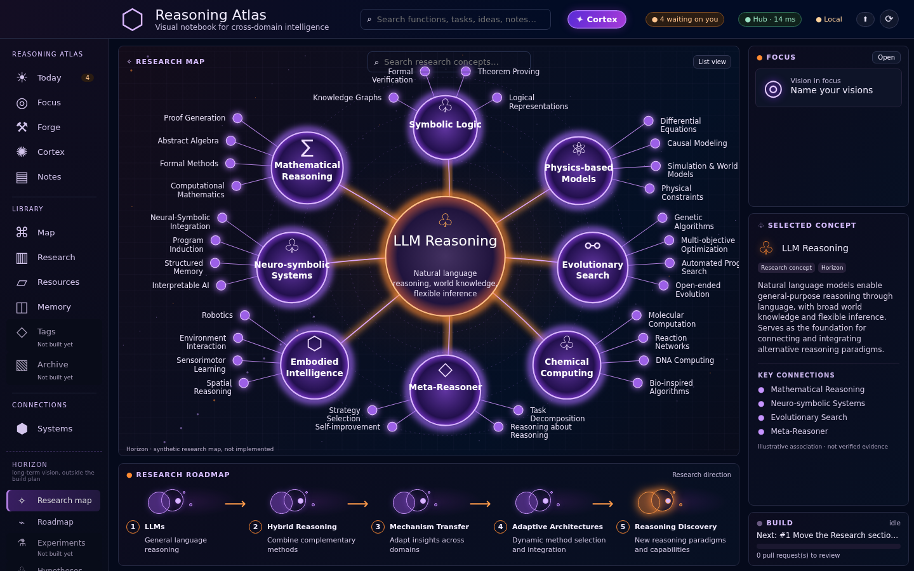
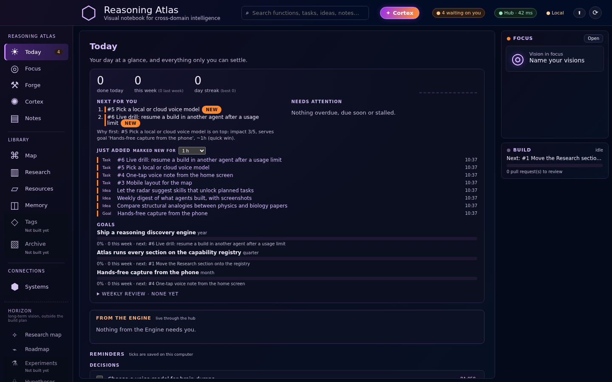
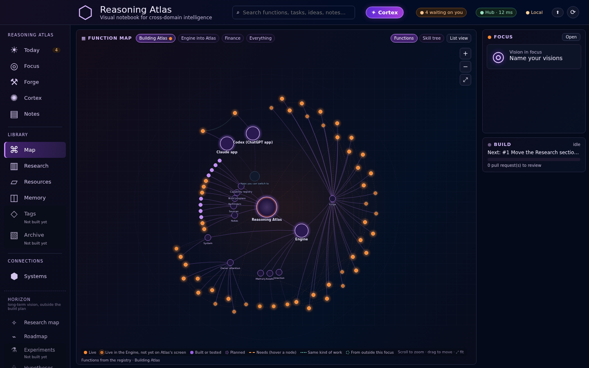
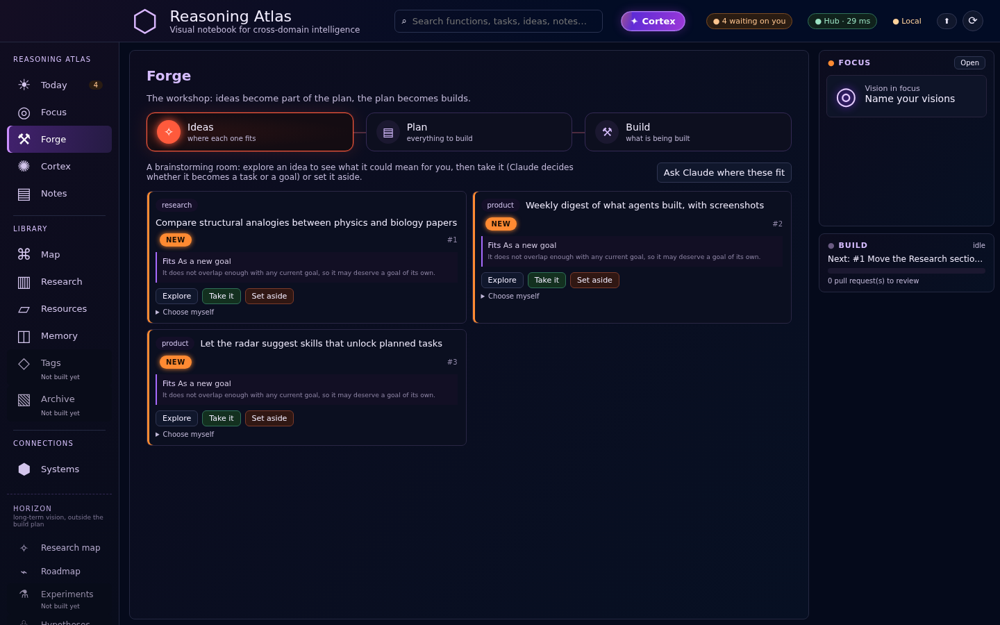
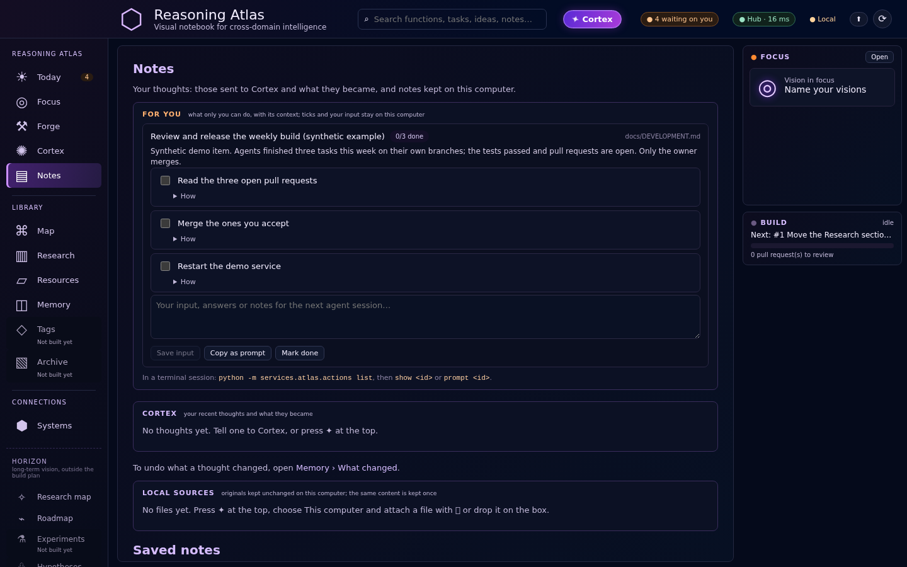
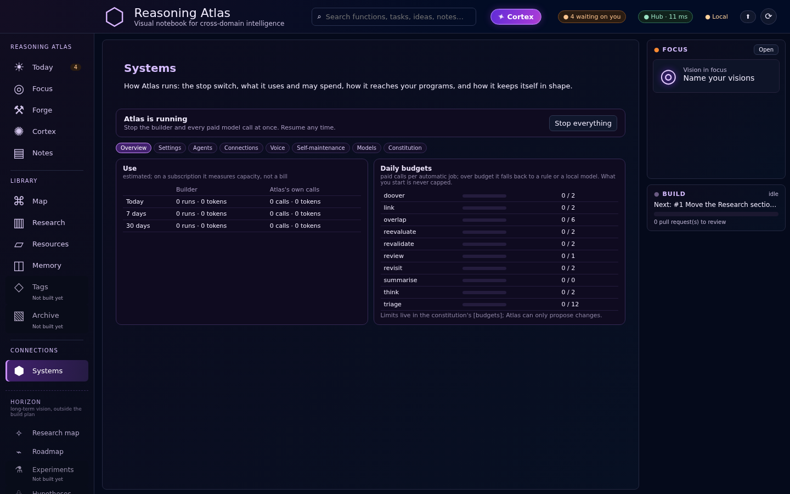
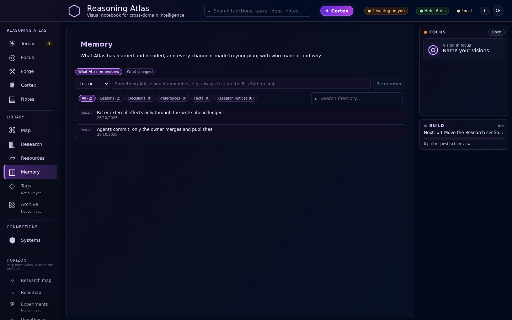
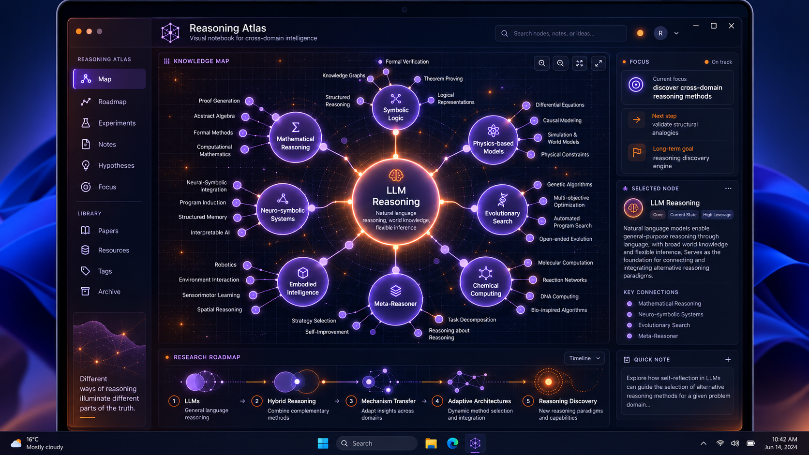

# Reasoning Atlas

**A self-hosted engine and map UI that remembers, plans, and lets AI coding agents build its own backlog under hard safety rules.**

> **Demonstration only — not open source.** This repository is shown publicly for a limited time so
> reviewers can read the code. All rights are reserved; see [LICENSE](LICENSE). It is a curated
> snapshot of a private working repository: personal data, live hostnames and screenshot evidence
> were left out, and every screen below shows synthetic demo data.



## A look inside

| | |
|---|---|
|  |  |
| **Today** — the day at a glance: what to do next and why, what was just added, progress per goal, and only the decisions that are really the owner's. | **Map** — every Engine function from the capability registry as one graph: live, built or tested, planned, and what each one needs. |
|  |  |
| **Forge** — ideas become part of the plan and the plan becomes builds. Each idea shows where it fits before it is taken. | **Notes › For you** — steps only the owner can take, written by agents with context, a checklist and copyable commands. |
|  |  |
| **Systems** — the stop switch, usage per day and the daily model budgets the Engine cannot exceed. | **Memory** — lessons and decisions Atlas has learned, and every change it made to the plan, with who made it and why. |

## Overview for reviewers

**In one sentence:** a self-hosted system in which an always-on *Engine* on a Raspberry Pi keeps
my plan, memory and resources, runs coding agents (Claude Code) that build its own backlog under
hard safety rules, and a *Reasoning Atlas* screen that shows knowledge, capabilities and build
progress as one connected map.

### The problem
I work on many projects with AI coding agents. Three things kept going wrong: ideas and earlier work
got lost between chat sessions; agents stopped at usage limits and the work had to be re-explained;
and giving agents autonomy meant either constant permission prompts or unacceptable risk. I wanted
one system that remembers, decides what to build next, lets agents build it safely, and shows me
only the decisions that are really mine.

### What it does (implemented)
- **Engine (Python, stdlib only, `engine/`)** – SQLite memory as the single source of truth; a
  ranked plan of goals → tasks; "brain dump" intake from Telegram text/voice, the dashboard or the
  CLI, sorted into tasks/ideas by a model with a full change log and undo; links, screenshots and
  PDFs as untrusted data; a research radar (GitHub, HN, arXiv, Hugging Face, lab RSS feeds).
- **Dev loop (`engine/devloop.py`)** – Claude Code on the Pi takes AI-owned tasks one at a time,
  each on its own branch and worktree with a private database snapshot; the Engine runs the tests
  and only then pushes the branch and opens a pull request. I review and merge; a tested updater
  installs merged work. Daily limits on runs, tokens and spend; a kill switch stops everything.
- **Gatekeeper (`engine/gatekeeper.py`)** – a PreToolUse hook that checks every agent tool call
  against deny/allow rules before it runs (no secrets, no privileged or destructive commands, no
  pushing or merging by agents, no edits to the live configuration). Unknown actions are deferred
  to Claude Code's auto-mode classifier or sent to my phone with nonce-protected Approve/Deny.
  Packaged and tested separately in the [`agent-gatekeeper`](https://github.com/Djeddozo/agent-gatekeeper) repository.
- **Recovery** – usage-limit stops of Claude Code, Codex or the dev loop are detected from session
  logs and resumed from the last checkpoint; a write-ahead ledger keeps pushes and other external
  effects from repeating; crash incidents can trigger narrowly scoped, tested repair runs.
- **Model routing and budgets** – every model call goes through `models.complete(job, …)`: Claude
  API, Claude Code subscription or a local Ollama model on a GPU PC, with per-job daily budgets and
  fallbacks.
- **Atlas (`services/atlas/`, `apps/web/`)** – a React/TypeScript screen and Python service. A
  capability registry exposes the Engine's functions (85 registered) to Atlas: reads carry
  provenance, proposals need a preview plus one confirmation and are never sent twice, actions are
  refused; the Engine is reached through an authenticated hub over Tailscale.

### Architecture
```text
Phone (Telegram, ntfy, PWA) ─┐                     ┌─ GitHub (branches, PRs, reviews)
Windows PC: Atlas UI ────────┼─ Tailscale ─► Raspberry Pi ─┤
                             │                 ├─ Engine: memory (SQLite), plan, brain, radar
                             │                 ├─ Dev loop → Claude Code (worktree + DB snapshot)
                             │                 ├─ Gatekeeper hook on every agent tool call
                             │                 └─ Hub API (token) for Atlas
GPU PC (optional): Ollama / Whisper for local models
```

### Engineering decisions worth discussing
- **Agents commit, humans publish.** Safety lives in hard rules outside the model (the hook), with
  model judgement only for what the rules do not cover.
- **Proposals, not actions.** Anything that spends money, sends messages, publishes or installs
  outside code becomes an approval row and waits.
- **Idempotent external effects.** A write-ahead ledger and preview/confirm protocol make retries
  after a crash or a usage limit safe.
- **Untrusted input is data.** Web pages, repos, emails and files never become instructions.
- **Provider independence.** Any Claude or Codex session can resume from the repository alone
  (`STATE/`, `HANDOFF.md`, task IDs, evidence files).

### My role
I own the product, the architecture, the safety model and every merge. Most code was written by AI
coding agents (Claude Code, Codex) working inside this system, which is the point of the project:
I designed the process that lets agents build reliably — task specifications, evidence files, tests,
the gatekeeper, review and recovery. The commit history shows the co-authorship.

### Status
In daily use on my Raspberry Pi. The full test suite (661 test functions, `python3 -m unittest discover -s tests`) passed on 2026-10-23;
the Atlas screen implements the map, focus, build progress, "waiting on you" and the Engine
connection, while several sections (Experiments, Hypotheses, Papers, …) are still marked "Not built
yet". Progress per task: [STATE/CURRENT_PROGRESS.md](STATE/CURRENT_PROGRESS.md); the evidence
notes are in `STATE/evidence/` (their screenshots stay in the private repository).

### Next steps
Finish moving Atlas sections onto the capability registry; the live drill for cross-provider
recovery (RA-015); mobile layout; the reasoning-research sections of the map.

---

## Project documentation

The Windows mockup below is the authoritative visual reference; the screens above are the implementation.



## Start here
- [Vision — why this exists](VISION.md)
- [Vision questions](VISION_QUESTIONS.md)
- [Current progress](STATE/CURRENT_PROGRESS.md) · [Handoff and resume prompt](HANDOFF.md)
- [Product requirements](docs/PRODUCT.md) · [Design contract](docs/DESIGN.md) · [Interactions](docs/INTERACTIONS.md)
- [Knowledge, skills, capabilities and memory](docs/DATA_MODEL.md)
- [Windows, Raspberry Pi and Git architecture](docs/ARCHITECTURE.md)
- [Engine / Forge / Research integration](docs/INTEGRATION_ENGINE.md)
- [Codex and Claude desktop workflow](docs/DEVELOPMENT.md)
- [Roadmap](ROADMAP.md) · [Testable tasks](TASKS.md) · [Decisions](DECISIONS.md)
- [Sources](docs/SOURCES.md) · [Requirements coverage](docs/COVERAGE.md)

## Project language
**English is the project's working language:** UI, documentation, source identifiers, comments, tests, branches, commits and issues. Preserve original quotations, imported data, external identifiers and source provenance when translation would change their meaning. Conversation with the owner may remain in Dutch.

## Development entry point
For the owner and the agents working on the private repository: clone it with GitHub Desktop, open the local folder as a project in Codex or the Code environment in Claude desktop. Read AGENTS.md, STATE/CURRENT_PROGRESS.md and HANDOFF.md, then choose one ready task. Daily use and handoff must not require the owner to operate a CLI.

This repository is independent of HQ-APP. The Engine is the first integration partner and remains authoritative for its own memory and build execution. Runtime databases, personal knowledge imports and secrets do not belong in Git.

## Blueprint validation
Run `python scripts/validate_blueprint.py --require-reference`. It checks required files, local links, JSON, task dependencies, reference hash and dimensions. A pass validates this package, not application behavior or visual fidelity of an implementation.

The Vision Room issue provides a persistent place for questions. An active Codex/Claude session can answer them and update the vision; no automatic answer bot has been installed.

---

The engine described below used to be the separate HQ-APP repository. It now lives here (ADR-019); HQ-APP is archived. Run Atlas's screen with `Start Atlas.cmd`; the engine runs on the Pi as before.

## Engine

A personal management system that remembers everything you give it, ranks what to do next, and grows
in phases toward an always-on, voice-controlled agent. See `docs/ROADMAP.md` for the vision and
timeline, and `CLAUDE.md` for how Claude Code should extend it.

### Start (Python 3.11+, no installs needed)
The brain dump and `hq think` need a model: set `ANTHROPIC_API_KEY`, or run Ollama on your GPU PC.
Without either, dumps are still saved and `todo:` / `idea:` lines are still routed.
```bash
./atlas.sh init --seed        # create memory/hq.db with the starting roadmap
./atlas.sh brief              # today's priorities
./atlas.sh next               # ranked list of what to do
```

### On the Raspberry Pi
```bash
gh repo clone Djeddozo/hq-app ~/hq-system && cd ~/hq-system
bash deploy/setup-pi.sh      # .env with token + push topic, database, schedules, gatekeeper, dashboard
```
Then install the ntfy app on your phone and subscribe to the topic the script prints.
Schedules live in `deploy/schedules.sh`; every update re-applies them, so new cron jobs need no re-run of the setup.

### Gatekeeper (approvals without the terminal)
Claude Code on the Pi runs in auto mode and asks the Engine before every action (`deploy/claude-settings.pi.json` →
`~/.claude/settings.json`). Hard rules allow or refuse instantly; everything else is judged by Claude Code's
auto-mode classifier, not by you. Your phone only gets conceptual decisions, as one button per option
(`./atlas.sh ask "..." --options "A|B|C"`). Start the Pi session with:
`claude --permission-mode auto --remote-control "Atlas Pi"` (inside tmux).
Rules: `[gatekeeper]` in `config/constitution.toml`. Test a rule: `./atlas.sh gate --check "pip install x"`.
Scripts can ask too: `./atlas.sh ask "Buy 1TB SSD" --cost 60 --reason "Pi storage" --wait 600`.

### Telegram (text and voice from your phone)
1. In Telegram, open **@BotFather**, send `/newbot`, choose a name and a username ending in `bot`.
   BotFather replies with a token like `123456:ABC...`.
2. On the Pi, put it in `.env`: `TELEGRAM_BOT_TOKEN=123456:ABC...`
3. Send your new bot any message (e.g. "hi"), then run:
   ```bash
   set -a; . ./.env; set +a
   ./atlas.sh bot --whoami          # prints TELEGRAM_CHAT_ID=<number>
   ```
   Put that line in `.env`. The Engine acts only on your private chat with the bot (not groups) and ignores everyone else.
4. Re-run `bash deploy/setup-pi.sh` (starts the bot, keeps it running, sends the brief at 06:55).

In Telegram: any text goes to `hq dump`; voice notes are transcribed and then dumped (needs a Whisper
endpoint on the GPU PC in `HQ_WHISPER_URL`, or a cloud service, see `docs/VOICE.md`; without one the
recording is kept and noted in memory). The dashboard's Talk button uses the same Whisper path when available.
Commands: `/next`, `/brief`, `/approvals`, `/radar`, `/help`. Pending approvals arrive with Approve/Deny
buttons. Test without the background service: `./atlas.sh bot --once`. Log: `memory/bot.log`.

### Dashboard
`./atlas.sh link` prints the dashboard link (`/dashboard` in Telegram does the same). Open it once per
browser; the page remembers the token. The token (`HQ_TOKEN` in `.env`) is created automatically the first
time you run `setup-pi.sh`, `hq serve` or `hq link`. For your phone, run `bash deploy/phone-dashboard.sh`
once Tailscale is set up, so the link uses the Pi's Tailscale address.

For HTTPS (required for the Talk button), run `bash deploy/https-dashboard.sh`.
It uses `HQ_PORT` from `.env` for the local dashboard (default `8765`) and
`HQ_HTTPS_PORT` for the Tailscale HTTPS listener (default `443`). If other apps
already use those ports, choose free ports in `.env` first, for example
`HQ_PORT=8770` and `HQ_HTTPS_PORT=8770`. Open the new link printed by the script;
the old direct HTTP address no longer works once the Engine binds to localhost.

### The brain
Drop any thought (Telegram text or voice, the dashboard, `./atlas.sh dump "..."`) without choosing "task" or
"idea": it is stored as a thought and Claude sorts it into the plan (tasks, ideas, goals, notes, updates).
One rule decides: something you have decided to do becomes a **task** (in the plan, ranked); something you
might do becomes an **idea** (in the idea list); when unsure, an idea. The reply lists every item with its
number and where it went. An idea becomes a task when you promote it (or Claude's re-evaluation does);
it then shows "→ task #N", and undoing that task reopens the idea. `./atlas.sh flow` prints the full map.
Every morning (06:35, before the brief) Claude re-evaluates the whole plan: re-prioritises, links tasks to
goals, hands software work to the AI agent, and turns ideas you clearly want into tasks. Dropping or
merging tasks is only suggested. Every change is listed with its reason and can be undone.
```bash
./atlas.sh brain            # Claude's focus, recommended actions, latest changes
./atlas.sh brain think      # re-evaluate now
./atlas.sh brain log        # every change with its reason;  ./atlas.sh brain undo 12
./atlas.sh ideas            # open ideas (--all: also those that became tasks)
./atlas.sh promote 4 --ai   # idea #4 becomes a task for the AI agent (without --ai: for you; 'queue' still works)
./atlas.sh flow             # where things go: thought → task or idea → task
```
Dashboard: **Ideas** → "My task" / "AI queue" buttons; **Plan** → "What Claude changed" with Undo and
"Re-evaluate now". Telegram: `/brain`, `/think`, `/promote 4 ai`, `/flow`, `/undo 12`.

### Which Claude does the Engine's thinking?
The Engine's own thinking (sorting brain dumps, weekly review, the brain) goes through `models.complete` and
tries, in order: the **Claude API** (when `ANTHROPIC_API_KEY` is in `.env`; stops at `monthly_cap_usd` in
`[models]`), then **Claude Code on the Pi** (your Claude subscription; no API key needed, just the
login from `claude`), then a **local model** on the GPU PC. So it works today with the subscription only,
and moves to the API by itself once you add a key. The kill switch blocks the API and Claude Code.

### Updates
Merged work goes live on the Pi by itself: every 15 minutes the Engine checks GitHub, runs the tests on the new
version in a separate copy and, only if they pass, installs it and restarts the dashboard and the bot
(you get a Telegram message with what changed). Right away: the **Update** button in the dashboard header,
`/update` in Telegram, or `./atlas.sh update` (`--check` to only look). It never overwrites changes made by
hand on the Pi; it stops and tells you instead. Settings that belong to this Pi only go in
`config/local.toml` (not in git), which is merged over `config/constitution.toml`.

### Dev loop: an agent on the Pi that keeps building
Claude Code on the Pi works through the tasks owned by the AI, one per run, every 3 hours. Each run gets
its own branch and working copy; the Engine runs the tests and, only if they pass, pushes the branch and opens a
pull request. You review and merge; the Engine marks the task done once it is in `main`. It never merges, never
pushes to `main`, and cannot read `.env` or edit the Engine's live configuration.
Build commands receive a private SQLite snapshot through `HQ_DB`, outside the worktree. Unmerged code
and migrations cannot change live memory through these commands; the snapshot is reused for a repair
attempt and removed when the run finishes. Follow-ups, lessons and questions belong in the final
summary/PR, because changes made in the snapshot are not imported. This isolates normal build commands;
it is not an operating-system sandbox against deliberate access to other files.

Switch it on (once):
```bash
curl -fsSL https://claude.ai/install.sh | bash     # install Claude Code on the Pi
claude                                             # log in with your Claude account, then /exit
gh auth login                                      # optional: real pull requests instead of compare links
bash deploy/enable-devloop.sh                      # shows what it changes and asks first
```
Controls: dashboard → **System** tab (live log of what it is doing, runs, PR links, Pause / Run now / Stop,
usage), Telegram `/dev` (`/dev pause`, `/dev resume`, `/dev run`, `/dev stop`), or `./atlas.sh dev ...`.
Limits (runs per day, minutes and turns per run) are in `[devloop]` of the constitution.
Switch it off again: `bash deploy/enable-devloop.sh --off`.

**What it builds, in which order** (dashboard → Today → **Build path**): the Engine keeps a skill tree of the
capabilities your digital company has and could have (Foundation, Operations, Thinking, Reach, Making,
Products). Tasks build capabilities; ideas hang on the capability they build on. The agent only builds
what the tree allows (a task whose foundations are not unlocked yet waits), takes the frontier first, and
follows your focus: **Plan**, **Balanced** or **Ideas**. **Your queue comes first**: tasks you give to the AI yourself (→ AI, an idea's → AI queue, ✎ owner ai, `hq add task --owner ai`) are built first, in your order (↑ moves one to the front), without asking for approval; ▶ Run on any task in the build queue builds it now, even one that waits for another task. The Engine's own proposals come after your queue. Big steps (over `approve_over_hours`, default 4,
in `[devloop]`), a new product or capability, or anything external (accounts, money, publishing, email)
wait for your Approve on the phone or on Today; meanwhile it builds the next task. Claude's daily
re-evaluation places new ideas on the tree and proposes new capabilities; just before it, Claude links
open tasks that build no capability yet to the one they build (`./atlas.sh tree autolink`, `--dry` to preview,
`--undo` to take the last run back; a link you changed or undid is never redone). Everything is editable with ✎
(tasks, ideas, goals, capabilities) and undoable under Plan → What changed. Also `./atlas.sh tree` and
Telegram `/tree` (`/tree focus ideas`, `/tree ok 12`).

**Kill switch**: the red button on the System tab, `/kill` in Telegram or `./atlas.sh kill`. It stops the
current run at once, blocks new runs and blocks every paid model call (local models keep working).
Undo with `/resume` or `./atlas.sh unkill`.

**Usage**: `/usage` or `./atlas.sh usage` (and the System tab) show tokens and estimated cost per day, week
and month, for agent runs and for the Engine's own model calls. Set `cloud_usd_per_mtok_in/_out` in `[models]`
to turn the Engine's token counts into euros/dollars.

### The plan as a tree
Goals can sit under bigger goals (life → year → quarter → month → week); tasks belong to a goal.
```bash
./atlas.sh plan                                     # mission → goals → tasks, with progress per goal
./atlas.sh add goal "Pass the autumn exams" --horizon quarter --parent 3
./atlas.sh nest 1 3                                 # put goal #1 under goal #3 (0 = top level)
./atlas.sh attach 42 1                              # link task #42 to goal #1 (0 = unlink)
```
Dashboard → **Plan** shows the same tree (fold goals open/closed, move a goal with "under:", link
unlinked tasks with the dropdown). Telegram: `/plan`.

### Progress tracking
```bash
./atlas.sh run 12           # hand task #12 to the agent; it marks it done once implemented
./atlas.sh delete 12        # discard a task as a suggestion (undoable)
./atlas.sh progress         # this week vs last, streak, progress per goal, overdue
./atlas.sh review           # weekly review (also runs Sunday 18:50 and is sent to Telegram)
```
Dashboard → **Plan → Progress**: tasks completed per day (4 weeks), streak, goal progress, overdue, due this
week, tasks stuck "in progress", recently done (with undo) and the latest weekly review.
Telegram: `/progress`, `/run 12` and `/delete 12` (numbers come from `/next`). Tasks cannot be ticked off by
hand: only the agent marks a task done, after implementing it (`hq done` works only with `HQ_ACTOR=agent`).

### Intake (links, screenshots, scans)
Send a link, a screenshot or a file to the Telegram bot, or use the CLI:
```bash
./atlas.sh intake https://example.com/article --note "for the Pi build"
./atlas.sh intake ~/Downloads/schedule.png
./atlas.sh intake --pending        # items waiting to be read
./atlas.sh intake ~/Downloads/letter.pdf
./atlas.sh intake --retry          # read waiting screenshots and scans (also runs hourly)
```
Links are fetched (public addresses only) and summarised into memory. Screenshots are read by a vision
model: `local_vision_model` in Ollama on the GPU PC first, otherwise Claude (needs `ANTHROPIC_API_KEY`);
with neither, they wait and are read later. PDFs (sent as a file or behind a link) are read from their text
layer and summarised; a scanned PDF without text has its first page read like a screenshot. This uses
`pdftotext`/`pdftoppm` from poppler-utils when installed (`sudo apt install poppler-utils`, recommended);
without it a built-in reader handles ordinary text PDFs, and scans wait. Other files are stored for a later reader.
The content of a page or image is only ever data; your own words sent with it go to `hq dump`.

### Daily use
```bash
./atlas.sh inbox "todo: book driving lesson"        # capture anything; re-ranks instantly
./atlas.sh inbox "idea: automate NAS health checks"
./atlas.sh inbox "exam moved to 20 Nov"              # plain text is stored as information
./atlas.sh run 3                                    # hand a task to the agent
./atlas.sh add resource "Synology NAS" --category hardware --details "8TB, 60% used"
./atlas.sh add task "Set up VPS" --effort 3 --impact 5 --due 2026-10-25 --after 5
./atlas.sh recall NAS                               # search memory
./atlas.sh approvals                                # what the Engine is waiting on; `approvals 2 approved`
./atlas.sh cycle                                    # one loop cycle (scheduler runs this hourly)
./atlas.sh cycle --think                            # let Claude propose (needs ANTHROPIC_API_KEY)

./atlas.sh serve                                    # dashboard at http://127.0.0.1:8765
./atlas.sh dump "long, unstructured thoughts..."    # brain dump → tasks, ideas, goals, updates
./atlas.sh radar scan                               # what's new today (GitHub, HN, papers, models)
./atlas.sh arsenal add ~/Projects/finance-app       # index something you built, for reuse
./atlas.sh arsenal find "currency conversion"       # find reusable functions across all projects
```

### With Claude Code
Open this folder in Claude Code and say: *"Read CLAUDE.md, run `./atlas.sh brief`, and build the next
AI-owned task."* It will work through the roadmap one task at a time and mark progress in the database.

### Files
- `config/constitution.toml` — the rules and limits (you edit this; the Engine never does)
- `memory/hq.db` — the shared memory (git-ignored; back it up)
- `seeds/roadmap.toml` — starting goals, phased tasks and dates
- `briefs/` — daily briefs as Markdown
- `docs/COMPUTE.md` — how the Pi, GPU PC, cloud models and subscriptions divide the work

### Build management and recovery
Use **Today → Build now** to turn the text directly into an agent task and start it.
**Save a thought for later** keeps the existing brain-dump workflow. If another run or
an access gate prevents starting, the new task is kept and the Engine shows the reason.
**Plan → Task overview** searches titles, descriptions and IDs, filters by creation dates
and recommendation, and sorts newest/oldest or by priority. **Why this?** opens the build
briefing, separating recorded facts from the agent's assessment and missing information.
**Help** replays the interactive guides; new versioned guides are offered on arrival.

When Claude expires, use **System → Claude connection → Reconnect Claude**, open the official
sign-in link and paste the returned code into the Engine if prompted. The official CLI stores the
renewed credentials; the Engine does not log or store the code. This is the same subscription used
by the planning calls and build runner.

The optional user timer `deploy/hq-recovery.timer` runs `python3 -m hq.recovery` independently
of the dashboard every two minutes. Install its service and timer under `~/.config/systemd/user/`,
then `systemctl --user daemon-reload` and `systemctl --user enable --now hq-recovery.timer`.
Enable automatic repairs in System. The watchdog groups crashes into incident tasks,
respects the kill switch, pause, daily limits and outside-code gate, and attempts each repair
twice. Small unstacked repairs (at most eight files and 400 changed lines, app code plus a
regression test, no protected control/configuration files) can be merged automatically after
the exact commit passes tests and any GitHub checks pass. Then the normal tested updater
installs it. Broader changes remain for review. The System panel reports blockers, including
expired Claude access. A restarted service is not itself evidence that its code bug is fixed.

---

## License

Copyright © 2026 Djeddi Noya. **All rights reserved.** This code is published for demonstration
only; no permission is granted to use, copy, modify or distribute it. See [LICENSE](LICENSE).
