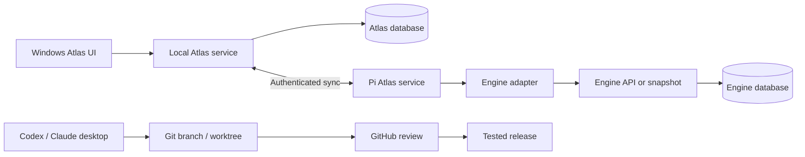

# Windows + Raspberry Pi + Git architecture

## Proposed topology
Windows: React/TypeScript client, local Atlas service and SQLite. Start in a desktop browser; evaluate native Windows packaging after the visual and functional foundation.
Pi: optional always-on Atlas service with separate storage and an Engine adapter alongside existing Engine processes.
GitHub: source, specifications, synthetic fixtures, tests, reference image and checkpoints. No live database, credentials or personal knowledge.
GPU PC: optional local inference/embeddings. Its absence must not block saving, browsing or reading.

## Stack is provisional
Python 3.11+ aligns with existing Engine knowledge and SQLite. TypeScript supports the rich graphical UI. Select exact framework versions and lockfiles during RA-003. Choose SVG/canvas using fixture performance and accessibility, not fashion.
Keep Atlas separate; do not import Engine modules with implicit live side effects.

## Authority and offline operation
MVP: each dataset has one configured write authority, Windows or Pi. A Windows client using Pi authority keeps offline input in a durable outbox and marks it pending. Commands carry IDs and base revisions. Do not create two independent primary databases for the same dataset.
Read caches carry snapshotId and fetchedAt and become visibly stale on disconnect. Revision conflicts return 409 and retain both note versions; no silent last-write-wins. Acknowledged commands are not replayed. Deletions travel as tombstones.
General multi-master synchronization is later scope.

## Network and credentials
Bind to loopback unless an explicit private-network configuration is established. Use authenticated HTTPS over a configured private route for Windows–Pi; do not expose a router port by default.
Keep Engine token server-side; the Atlas client uses its own session. Never place secrets in URLs, browser storage or logs.
The observed Engine authentication function permits requests if HQ_TOKEN is absent. The adapter must require an explicit token/configuration and approved endpoint rather than treating that as public access. This blueprint does not modify Engine authentication.
Health exposes version, schemaVersion, adapter capabilities and last successful synchronization, not a fabricated connected state.

## Deployment and recovery
Allocate a distinct port, service account and data directory; do not take over the Engine's systemd unit or port. Verify actual Pi architecture, RAM, disk and occupied ports first.
Build on the development host/CI and test ARM64 compatibility on Pi. Pin a release commit. Use the SQLite backup API or another consistent snapshot, never an arbitrary copy of an active WAL database.
Release sequence: backup → migration rehearsal → tests → activate version → health check → restore if needed. Binary rollback requires compatible schema; otherwise restore the matching backup. Rehearse with fixtures.
The Engine's updater must not mistake Atlas work for an Engine release. Atlas needs its own release process.

## Planned implementation layout
apps/web/; services/atlas/; packages/contracts/; adapters/hq/; fixtures/; tests/; docs/; design/; assets/reference/; STATE/.
These are planned implementation locations, not claims that application code already exists.
